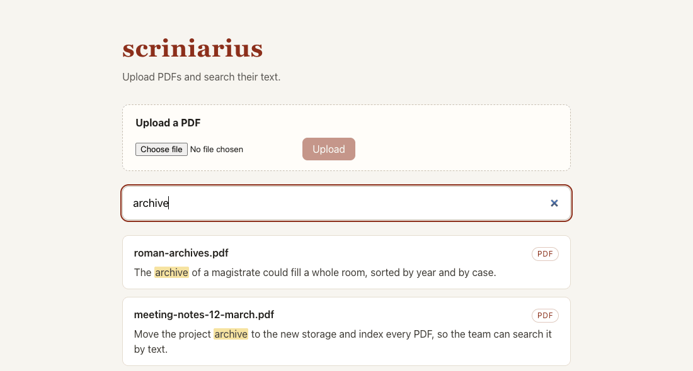

# scriniarius

[](https://github.com/FaustoS88/scriniarius/actions/workflows/ci.yml)

Upload PDFs and search their text. A NestJS API sends each file through an OpenSearch ingest pipeline that extracts the text, and a React page searches it as you type.

*A scriniarius was a clerk of the scrinia: the boxes, and later the offices, in which the Romans kept scrolls and documents.*



## How it works

The page posts the chosen PDF as multipart to `POST /search/index`, in a `file` part with the file name as its `title`; from a terminal, `curl -F file=@report.pdf -F title=report.pdf http://localhost:3000/search/index` does the same. Tags go one part each (`-F tags=sea -F tags=harbour`), and a single part makes a list of one. The API takes files up to 50 MiB and answers 413 to anything larger. It validates the other fields (unknown ones are rejected), turns the file into the base64 that OpenSearch's attachment processor reads (OpenSearch accepts at most 50 million characters in one JSON string, about 36 MiB of file, so the compose file raises that to 70 million), and indexes the document into `documents` through the `attachments` pipeline. There, OpenSearch's ingest-attachment plugin extracts the text, up to 100,000 characters, into `attachment.content`, and the pipeline drops the base64 so search hits stay light. A document without a file (title, body, tags) can also come as JSON, up to 100 KB, and is indexed as it is. OpenSearch answers 429 when it is too busy to take a document, for instance with two large uploads at once; the API passes that on, so the caller can try again.

`GET /search?q=...` runs a `simple_query_string` over every field, with `from` and `size` (up to 100) for paging; before the first upload it answers an empty list. Paging that is not a number gets a 400, and so does a request OpenSearch refuses, such as paging past the first 10,000 hits, with OpenSearch's reason. The page calls it 300 ms after you stop typing. `DELETE /search/index` drops the index.

## Security choices

- The API sends `Authorization: ApiKey ...` with a key that can read, write and manage only the `documents` index; on the cluster it gets just `cluster:monitor/main`, for the startup check, and `indices:data/write/bulk`. The key lasts 30 days.
- `scripts/setup-opensearch.sh` creates the key as admin, writes it to `.env` without printing it, and revokes the previous key only after the new one is saved.
- OpenSearch errors carry the request with its `Authorization` header, so the API logs only their name, status and message.
- Secrets live in `.env`, which git ignores and `.dockerignore` keeps out of image builds; compose passes each container only what it needs, the admin password to OpenSearch and the key to the API. `.env.example` has empty values.
- OpenSearch is pinned to 3.10.1 (API keys need 3.7 or later), and the image turns API keys on before the security index is first created: the build fails if that edit does not land.
- This setup is for local development: OpenSearch serves the demo certificate it ships with, signed by its own demo CA, and the API's client accepts it without checking it.

## Run it locally

You need Docker and curl. Every command starts from the repo root.

```bash
git clone https://github.com/FaustoS88/scriniarius.git
cd scriniarius

cp .env.example .env    # set OPENSEARCH_INITIAL_ADMIN_PASSWORD: a strong password, in single quotes

docker build -t scriniarius-opensearch:latest .
docker compose up -d --wait opensearch    # OpenSearch on https://localhost:9200, once it answers
./scripts/setup-opensearch.sh             # the ingest pipeline and the API's key, written to .env

docker compose up -d --build              # the API on port 3000 and the page on http://localhost:5173
```

The API checks OpenSearch and its key when it starts and stops there if either fails; `docker compose logs api` shows `OpenSearch OK 3.10.1` when both are fine. The smoke test uploads a sample PDF through the API, finds it by a word of its text, and deletes what it wrote:

```bash
./scripts/smoke-test.sh
```

The OpenSearch image is built with `docker build`, not by compose, because a new image means a new OpenSearch container, and the compose file has no volumes: a new container starts without the index and the key. After `docker compose down`, or after rebuilding that image, bring OpenSearch up and run the setup script again (its note that the previous key was not revoked is expected then) before `docker compose up -d`. Run the script again within 30 days as well, to replace the key; `docker compose up -d` then restarts the API with the new one.

The page calls the API at `http://localhost:3000`. The address is fixed in its JavaScript when the page is built, so to call the API somewhere else, set `VITE_API_URL=https://api.example.com` in `.env`, where compose reads it for every later build too, and rebuild the page with `docker compose up -d --build page`.

## Develop

To work on the code with reload on save, run only OpenSearch in Docker (the first steps above, or `docker compose stop api page` if everything is up), and start the API and the page with Node 24.15 or later, each in its own terminal:

```bash
cd backend && npm install
(set -a; . ../.env; set +a; npm run start:dev)    # the API on port 3000, with .env loaded only for it
```

```bash
cd frontend && npm install
npm run start:dev    # the page, served by Vite on http://localhost:5173
```

Vite reads `VITE_API_URL` there too: `VITE_API_URL=http://localhost:3001 npm run start:dev` points the page at an API on port 3001.

## Tests

`cd backend && npm test` runs the unit tests of `SearchService`, against a fake OpenSearch client, and the HTTP tests of the API built from its real module with the service faked: routes, paging, validation and the answers to OpenSearch errors. `cd frontend && npm test` renders the page in jsdom with `fetch` faked: the results with the matched words marked and any other HTML shown as text, the empty and error states, `?q=` in the address and the upload. The smoke test above covers the rest against a real OpenSearch. `./scripts/large-upload-test.sh` uploads the largest PDF the API takes, exactly 50 MiB, and finds it by its text: its base64 fits in one JSON string only because the compose file raises OpenSearch's limit, so the test fails if that line goes.

GitHub Actions runs them on every pull request and on every push to `develop` and `main` (`.github/workflows/ci.yml`). One job lints, builds and tests the API and the page. The other builds the OpenSearch image, starts it with an admin password made for the run and masked in the logs, runs the setup script, starts the API and the page from the compose file, runs the smoke test and the large upload, and checks that the page is served.

## Layout

- `backend/`: the NestJS API (the search controller over a `SearchService`, the OpenSearch client and its error filter, request validation).
- `frontend/`: the React page (PDF upload, search as you type).
- `scripts/`: the setup script, the smoke test with its sample PDF, and the large upload test with the script that writes its PDF.
- `Dockerfile`: OpenSearch 3.10.1 with the ingest-attachment plugin and API keys on.
- `backend/Dockerfile`, `frontend/Dockerfile`: the API on Node 24, and the page built by Vite and served by nginx. Both build from the repo root.
- `docker-compose.yml`: a single OpenSearch node, the API and the page.
- `.github/workflows/ci.yml`: the two CI jobs.

## License

MIT, see [LICENSE](LICENSE).
