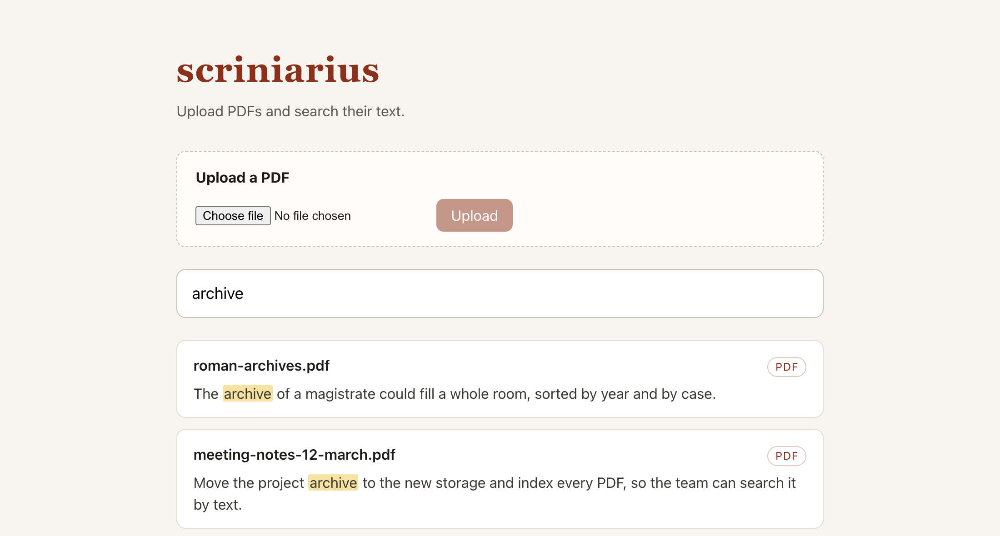

# scrinarius

[](https://github.com/FaustoS88/scrinarius/actions/workflows/ci.yml)

Upload PDFs and search their text. A NestJS API sends each file through an OpenSearch ingest pipeline that extracts the text, and a React page searches it as you type. The API reaches OpenSearch with a key scoped to its own index, never with the admin password.

*A scrinarius kept the scrinia, the boxes in which the Romans stored scrolls and documents.*



## How it works

The page reads the chosen PDF in the browser and posts it as base64 to `POST /search/index`, with the file name as its title. The API accepts JSON bodies up to 50 MB, so PDFs up to about 37 MB. It validates the body (unknown fields are rejected) and indexes it into `documents` through the `attachments` pipeline. There, OpenSearch's ingest-attachment plugin extracts the text, up to 100,000 characters, into `attachment.content`, and the pipeline drops the base64 so search hits stay light. A document without a file (title, body, tags) is indexed as it is.

`GET /search?q=...` runs a `simple_query_string` over every field, with `from` and `size` (up to 100) for paging; before the first upload it answers an empty list. Paging that is not a number gets a 400, and so does a request OpenSearch refuses, such as paging past the first 10,000 hits or an upload whose file is not base64, with OpenSearch's reason. The page calls it 300 ms after you stop typing. `DELETE /search/index` drops the index.

## Security choices

- The API sends `Authorization: ApiKey ...` with a key that can read, write and manage only the `documents` index; on the cluster it gets just `cluster:monitor/main`, for the startup check, and `indices:data/write/bulk`. The key lasts 30 days.
- `scripts/setup-opensearch.sh` creates the key as admin, writes it to `.env` without printing it, and revokes the previous key only after the new one is saved.
- OpenSearch errors carry the request with its `Authorization` header, so the API logs only their name, status and message.
- Secrets live only in `.env`, which git ignores; `.env.example` has empty values.
- OpenSearch is pinned to 3.10.1 (API keys need 3.7 or later), and the image turns API keys on before the security index is first created: the build fails if that edit does not land.
- This setup is for local development: OpenSearch serves a self-signed certificate, and the API's client accepts it.

## Run it locally

You need Docker and Node 20. Every command starts from the repo root.

```bash
git clone https://github.com/FaustoS88/scrinarius.git
cd scrinarius

cp .env.example .env    # set OPENSEARCH_INITIAL_ADMIN_PASSWORD: a strong password, in single quotes

docker build -t scrinarius-opensearch:latest .
docker compose up -d    # OpenSearch on https://localhost:9200

# wait until OpenSearch answers, then create the ingest pipeline and the API's key
set -a; . ./.env; set +a
until curl -skf -o /dev/null -u "admin:$OPENSEARCH_INITIAL_ADMIN_PASSWORD" https://localhost:9200; do sleep 5; done
./scripts/setup-opensearch.sh
```

In a second terminal, start the API, which logs `OpenSearch OK 3.10.1` and listens on port 3000 (if OpenSearch is down or refuses the key, it stops there):

```bash
cd backend && npm install
set -a; . ../.env; set +a
npm run start:dev
```

In a third terminal, start the page, served by Vite on http://localhost:5173:

```bash
cd frontend && npm install
npm run start:dev
```

With the API running, the smoke test uploads a sample PDF, finds it by a word of its text, and deletes what it wrote:

```bash
./scripts/smoke-test.sh
```

The compose file has no volumes, so `docker compose down` wipes the index and the key with it: after a fresh `up`, run the setup script again (its note that the previous key was not revoked is expected then). Run it again within 30 days as well, to replace the key.

## Tests

`cd backend && npm test` runs the unit tests of `SearchService`, against a fake OpenSearch client, and the HTTP tests of the API built from its real module with the service faked: routes, paging, validation and the answers to OpenSearch errors. The smoke test above covers the rest against a real OpenSearch.

GitHub Actions runs both on every pull request and on every push to `develop` and `main` (`.github/workflows/ci.yml`). One job lints, builds and tests the API and lints and builds the page. The other builds the OpenSearch image, starts it with an admin password made for the run and masked in the logs, runs the setup script, starts the API and runs the smoke test.

## Layout

- `backend/`: the NestJS API (the search controller over a `SearchService`, the OpenSearch client and its error filter, request validation).
- `frontend/`: the React page (PDF upload, search as you type).
- `scripts/`: the setup script and the smoke test, with its sample PDF.
- `Dockerfile`: OpenSearch 3.10.1 with the ingest-attachment plugin and API keys on.
- `docker-compose.yml`: a single OpenSearch node.
- `.github/workflows/ci.yml`: the two CI jobs.

## License

MIT, see [LICENSE](LICENSE).
